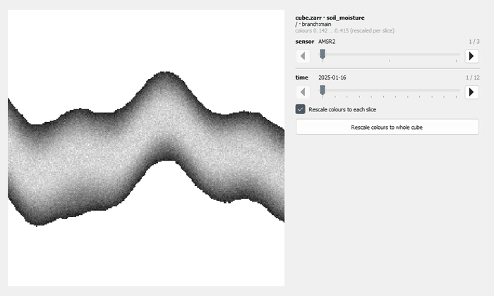
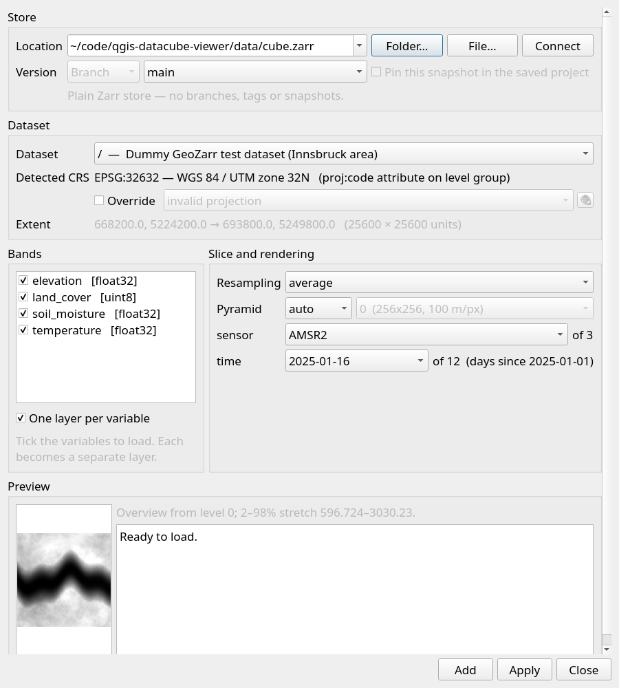
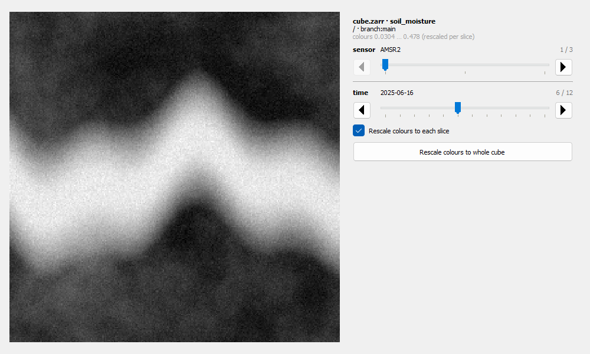

# Datacube Viewer

Loads GeoZarr datacubes into QGIS as raster layers with multiscale
pyramids. It works with [Icechunk](https://icechunk.io) repositories, regular Zarr
v3 stores and NetCDF files.



Sliders in a dock panel step through the non-spatial axes of the cube (time, sensor,
...) and redraw the layer as you drag.

| Pick a store, a version and the variables | Scrub through the axes |
| --- | --- |
|  |  |

## Supported formats

| Format | Where | Versions (branch / tag / snapshot) | Needs |
| --- | --- | --- | --- |
| **Icechunk** repository | local path, `s3://`, `gs://`, `az://`, `r2://`, `http(s)://` | yes | `zarr`, `icechunk` |
| **Zarr** store (v3, and v2 with `_ARRAY_DIMENSIONS`) | local directory, `http(s)://` (needs consolidated metadata), `s3://`, `gs://`, `az://` | no | `zarr`; `fsspec` + a filesystem package for the cloud schemes |
| **NetCDF-4 / HDF5** and classic **NetCDF-3** file (`.nc`, `.nc4`, `.cdf`) | local file; OPeNDAP URL ending in `.nc` (untested) | no | `netCDF4` |

The format is detected from the location: a regular file is NetCDF, a directory is
Zarr or Icechunk. The data model is the same in all three (groups, named dimensions,
arrays, attributes), so georeferencing, multiscale pyramids, CRS resolution and the
time/band sliders behave identically; the plugin reads them through a small
format-neutral layer (`core/nodes.py`), and a new format is one adapter against it.

NetCDF specifics:

- Groups are real NetCDF-4 groups. A group sees the coordinate variables and the CRS
  variable (`spatial_ref`, a grid mapping) of its parent groups, so one set of
  coordinates can be declared once at the top and shared by several data groups, as
  xarray and NCO write them. A group's own variables take precedence, and a coordinate
  is not inherited when a nearer group declares a different dimension of the same name.
- NetCDF attributes are flat, so structured metadata (`multiscales`, `zarr_conventions`)
  is read from JSON text attributes.
- Values are read as stored; `_FillValue`, `scale_factor` and `add_offset` are applied
  by the plugin, as for Zarr.
- Only one thread reads a given file at a time (HDF5 is not thread-safe).
- While a file is open in QGIS, other programs cannot write to it on Windows.
- A plain `https://` link to a `.nc` file cannot be read in place; download it.

## Installing

**Requires QGIS 3.40 LTR or newer.** `zarr` 3 needs Python ≥ 3.11
and `icechunk` needs ≥ 3.12, and 3.40 LTR is the first release whose standard builds
ship Python 3.12. Check with `import sys; print(sys.version)` in
**Plugins → Python Console**.

### 1. The plugin

**Plugins → Manage and Install Plugins → Install from ZIP**, and pick
`datacube_viewer-<version>.zip` (`pixi run build` makes one).

It is marked experimental, so tick **Settings → Show also experimental plugins**
if it does not show up in the list.

### 2. The Python packages

The Plugin Manager unzips plugins; it never runs pip. So this step is manual. No single
package is mandatory, but you need at least one of `zarr` or `netCDF4` — each adds the
formats listed above:

| Package | What it buys you |
| --- | --- |
| `zarr>=3` | Zarr stores, and Icechunk (which is built on it). |
| `icechunk` | Icechunk repositories, and their branches, tags and snapshots. |
| `netCDF4` | NetCDF files. |
| `fsspec` + `s3fs` | Plain Zarr on `s3://`, `gs://` and `az://`. `http(s)://` needs neither — the plugin reads it directly. For `gs://` use `gcsfs` and for `az://` use `adlfs` in place of `s3fs`. |

The easiest way is **Raster → Datacube Viewer → Install Python Dependencies…**. It
detects your environment, shows the command with your packages filled in, and on
Windows, macOS and Linux (system QGIS) its **Install now** button runs that command for
you. Restart QGIS afterwards. Install now never changes what QGIS's Python already has:

- It installs with `pip install --user`, into your user site-packages, never into
  QGIS's or the system's own.
- A constraints file pins every package QGIS's Python already has. pip can add
  packages, but not upgrade or downgrade one QGIS depends on (numpy in particular: zarr
  3.2 and newer want numpy 2, which would break GDAL's Python bindings built against
  numpy 1). It picks older versions of the new packages instead, and if none fit, it
  installs nothing and says so.
- Wheels only, so nothing gets compiled.
- Before pip runs, the interpreter has to confirm it is the one QGIS runs.
- Packages that need a newer Python than your QGIS has are not offered (see
  [below](#when-qgiss-python-is-too-old-qgis-from-conda-forge)).
- If you ask for something that is already installed in an older version (zarr 2 from
  your distribution, say), it asks first, because the new copy then takes precedence for
  every program using that Python.

In a conda environment and in Flatpak QGIS the dialog only shows the command. For
reference, the commands without the constraints file:

| | Where to run it | Command |
| --- | --- | --- |
| **Windows** | **OSGeo4W Shell** (Start menu → the QGIS folder). *Not* `cmd` or PowerShell: they have a different Python on `PATH`. | `python -m pip install --user "zarr>=3" netCDF4 icechunk fsspec s3fs` |
| **macOS** | **Terminal** (Applications → Utilities) | `/Applications/QGIS.app/Contents/MacOS/bin/python3 -m pip install --user "zarr>=3" netCDF4 icechunk fsspec s3fs` |
| **Linux** (system QGIS) | any terminal | `/usr/bin/python3 -m pip install --user "zarr>=3" netCDF4 icechunk fsspec s3fs` |
| **conda / pixi** | a terminal with the env activated | `conda install -c conda-forge "zarr>=3" netcdf4 icechunk fsspec s3fs` |
| **Flatpak** | any terminal | `flatpak run --devel --command=pip3 org.qgis.qgis install --user "zarr>=3" netCDF4 icechunk fsspec s3fs` |

Without the constraints file pip may upgrade numpy and other packages QGIS uses, so
prefer the dialog's command, which adds it. Drop what you do not need: each package
adds one kind of store, and you need at least one of `zarr` or `netCDF4`.

Then **restart QGIS** — packages are imported once per session, so re-enabling the
plugin is not enough. Confirm in the Python Console with

```python
import sys, importlib.util as u

print({m: u.find_spec(m) is not None for m in ("zarr", "icechunk", "netCDF4")}, sys.executable)
```

Notes that catch people out:

- **A bare `python3` on macOS is the wrong Python.** QGIS.app bundles its own; the
  absolute path is required. Use `QGIS-LTR.app` for the LTR build.
- **A bare `python3` on Linux can be the wrong Python too**, for example when conda's
  base environment is active. The system QGIS uses `/usr/bin/python3`.
- **Debian 12, Ubuntu 23.04 and newer, and Fedora refuse the plain command** (PEP 668:
  `error: externally-managed-environment`). The dialog adds
  `--break-system-packages` for you. With `--user` that writes only to your own
  `~/.local`, but whatever is there takes precedence over the system's packages for
  every program using that Python, which is why the dialog's command pins them.
- **Flatpak QGIS is sandboxed**, so the plugin cannot install into it from inside QGIS.
  The command in the table above is the one
  [Flathub documents](https://github.com/flathub/org.qgis.qgis); the packages live inside
  the sandbox and are lost when the Flatpak is reset.

### When QGIS's Python is too old: QGIS from conda-forge

This is the recommended route when the Python inside your QGIS cannot take the packages
above, for example the system QGIS on Ubuntu 22.04 or Linux Mint 21, which runs
Python 3.10. pip then answers `No matching distribution found for zarr>=3`, and no
install command can fix that, because QGIS is built against one Python version.
Install a second QGIS from conda-forge instead, with everything the plugin needs:

```bash
conda create -n qgis -c conda-forge "qgis=3.44" "zarr>=3" icechunk netcdf4 fsspec s3fs
conda activate qgis
qgis
```

- `qgis=3.44` keeps it on QGIS 3. Unpinned, conda-forge installs QGIS 4, which the
  plugin is not yet marked compatible with.
- The system QGIS stays as it is. Both use the same QGIS profile, so plugins installed
  in one show up in the other.
- If it dies at startup with `QGIS died on signal 11`, a font cache that another conda
  environment left in `~/.cache/fontconfig` can be the cause. Run `fc-cache -f` once
  with the environment activated, then start `qgis` again.

## Using it

**Raster → Datacube Viewer → Add Datacube Layer…**

**Raster → Datacube Viewer → Time Travel…**

## Developing

Layout:

```
datacube_viewer/          the QGIS plugin package (what the zip contains)
  core/                   format readers and store logic -- no QGIS imports
  gui/, provider/         Qt dialogs and the raster provider
scripts/                  build/deploy/inspect tooling, plus standalone PEP 723
                          scripts (dummy data, reference renderer, HTTP server)
tests/                    pytest suite
pixi.toml                 environment with QGIS in it, for the tests that need it
UPSTREAM.md               where the plugin came from, and what we changed
```

The scripts that check data (`scripts/plot_geozarr_reference.py`) read a store with
plain `zarr`, with no GDAL, no xarray and no QGIS, so when the plugin shows nothing,
or something odd, they say whether the data or the plugin is at fault.

Two environments, for two jobs. [uv](https://docs.astral.sh/uv/) runs everything that
does not need QGIS: the scripts and the core tests (tests that need QGIS skip
themselves). [pixi](https://pixi.sh) provides a QGIS from conda-forge for the rest.

```bash
uv sync --all-extras --group dev   # create .venv and install everything
uv run pre-commit install          # enable the lint hooks on commit
uv run pytest                      # tests, without QGIS
uv run ruff check . && uv run ruff format .

pixi run test                      # the full suite, including the Qt tests
pixi run build                     # build/datacube_viewer-<version>.zip
pixi run deploy                    # symlink into your QGIS profile
pixi run inspect                   # describe a store with no QGIS involved
```

### The plugin in QGIS

QGIS 3.44 LTR is installed and its bundled Python 3.12 **already has** `zarr` 3.4,
`icechunk` 2.3, `fsspec` and `s3fs`, so there is no pip step. `build_plugin.py` and
`deploy_dev.py` are standard-library only — neither needs pixi or the project venv:

```bash
python scripts/deploy_dev.py            # symlink into the QGIS profile
python scripts/deploy_dev.py --copy     # if symlinks are unavailable
python scripts/build_plugin.py          # -> build/datacube_viewer-<version>.zip
```

With the symlink in place and the **Plugin Reloader** plugin (already installed),
editing a file under `datacube_viewer/` and pressing reload picks the change
up without restarting QGIS. Then: **Raster → Datacube Viewer → Add Datacube Layer…**

Note that a second, unrelated GeoZarr plugin by Wietze Suijker (`qgis_geozarr`,
GPL-2.0) is also installed in the default profile and shows up under a similar
name. Disable it in the Plugin Manager if the two get confusing, and keep its code
at arm's length — its license is not MIT.

The tests that construct Qt widgets or the raster provider need QGIS plus
`pytest-qgis`, which `pixi run test` provides (`pixi.toml` lists `linux-64` and
`win-64`).

### Releasing the plugin

The git tag is the version — `metadata.txt` carries the placeholder `0.0.0` and the
build injects the real value, so the number lives in exactly one place:

```bash
git tag v0.0.2 && git push && git push --tags   # on main: CI tests, then builds the zip,
                                                # attaches it to a GitHub release and uploads it to plugins.qgis.org
```

Tag on `main` itself, after merging: the release job waits for the test run on `main`
for the tagged commit and fails if that commit was never pushed to `main`.

The registry upload needs the repository secret `QGIS_TOKEN`: the API token created on
the plugin's page on plugins.qgis.org (log in there with GitHub). The first upload of a
plugin is moderated there before it becomes public.

`v*` is the plugin's namespace, since the plugin is what this repository releases.
Untagged builds self-identify as `0.0.1.dev3+gabc1234` (or `+dirty`), so an
installable zip never passes for a release. A published version cannot be reused —
bump rather than retag. Details in [UPSTREAM.md](UPSTREAM.md).

## Diagnostics

Both scripts declare their dependencies inline (PEP 723), so they run without the
project environment.

`plot_geozarr_reference.py` checks a store's metadata (conventions, CRS, transform
vs. coordinates vs. bbox, shapes per level, no-data share) as PASS/WARN/FAIL, and
renders one PNG per level. It exits non-zero on any FAIL, so it also works as a
gate in a pipeline. `--gdal` additionally cross-checks CRS and geotransform the way
GDAL — and therefore QGIS — sees them:

```bash
uv run --script scripts/plot_geozarr_reference.py dummy.zarr
uv run --script scripts/plot_geozarr_reference.py dem.zarr --time 6 --gdal
uv run --script scripts/plot_geozarr_reference.py cube.zarr --index sensor=1 --index time=7
```

It finds the y and x axes by name, so a `--dim-order` store is checked and rendered
exactly like a conventional one - if the two differ, something is wrong. `--index
DIM=N` picks the slice per dimension (`--time` sets all of them at once), which is
what a store with more than one non-spatial axis needs.

`serve_zarr.py` serves a local store over HTTP with CORS headers and byte-range
support, which is what browser viewers and sharded Zarr v3 stores need and what
`python -m http.server` does not provide:

```bash
uv run --script scripts/serve_zarr.py dummy.zarr
```

## Test data

`scripts/make_dummy_data.py` writes a small GeoZarr store (elevation,
temperature, land cover) around Innsbruck. It declares its own dependencies
inline (PEP 723), so it runs without the project environment:

```bash
uv run scripts/make_dummy_data.py                           # -> dummy.zarr
uv run scripts/make_dummy_data.py --source copernicus -o dem.zarr
uv run scripts/make_dummy_data.py --zarr-format 2 --levels 1 -o flat_v2.zarr
```

`--sensors` adds a string `sensor` axis (`AMSR2`, `SMOS`, `SMAP`) and a 4-D
`soil_moisture` variable alongside the 3-D `temperature` and the 2-D fields, so one
store exercises two browsable axes at once, plus per-sensor nodata:

```bash
uv run scripts/make_dummy_data.py --sensors -o cube.zarr
uv run scripts/make_dummy_data.py --sensors ASCAT,SMAP -o ascat.zarr
```

`--dim-order` stores the variables under a permuted axis order. The pixel at a
given coordinate is the same in every layout - only the metadata moves - so a
reader that honours the dimension *names* sees identical data, while one that
assumes `(..., y, x)` by position does not:

```bash
uv run scripts/make_dummy_data.py --dim-order transposed -o yx_swapped.zarr
uv run scripts/make_dummy_data.py --dim-order y,x,time   -o time_last.zarr
uv run scripts/make_dummy_data.py --dim-order shuffled --sensors -o shuffled.zarr
```

The presets are `canonical`, `transposed` (y/x swapped), `axes-last`, `axes-split`
(y and x not adjacent) and `shuffled`, which gives every variable its own
permutation, drawn from `--seed` and stable across pyramid levels.

`--nest` buries the dataset inside nested groups (`--nest 3` gives
`survey/region/area/{0,1,2}`, or pass a path such as `--nest campaign/alps/inn`),
and `--format netcdf` (implied by a `.nc` output) writes the same data as NetCDF-4:

```bash
uv run scripts/make_dummy_data.py --nest 3 -o nested.zarr
uv run scripts/make_dummy_data.py --nest 3 --sensors -o nested.nc
```

## Origin

Datacube Viewer is a fork of [EODC's GeoZarr Viewer](https://github.com/eodcgmbh/qgis-geozarr)
(MIT); see [UPSTREAM.md](UPSTREAM.md) for what changed. It was renamed so it stays
distinguishable from upstream and from Wietze Suijker's similarly named plugin when
several are installed at once.
