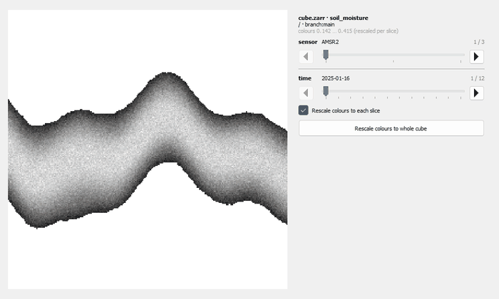
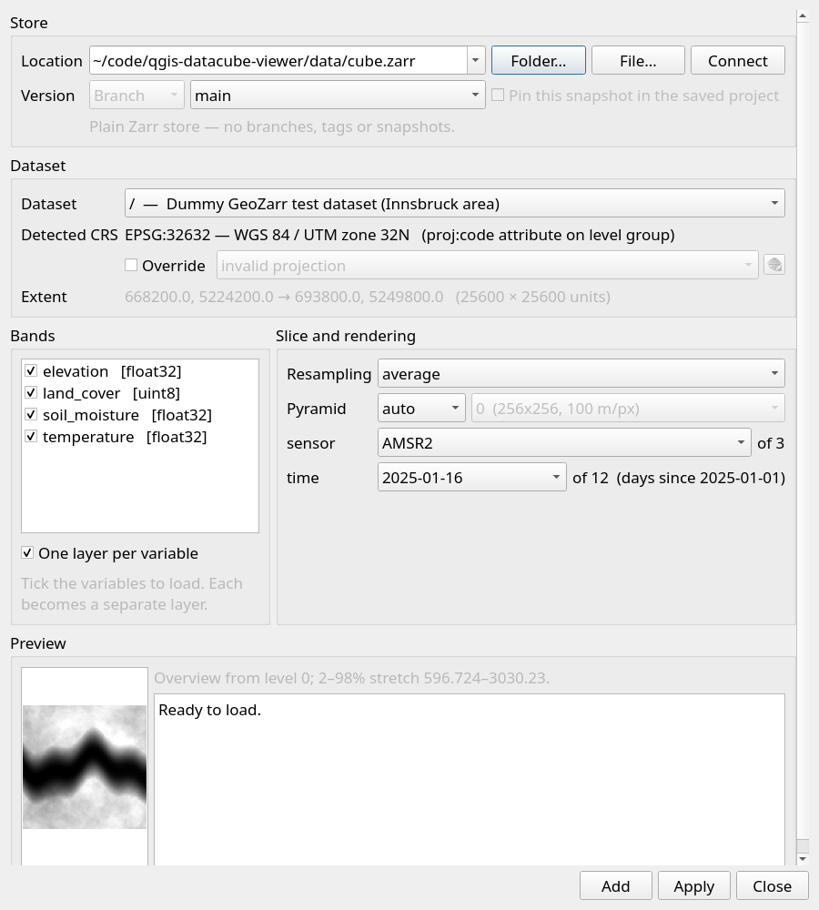
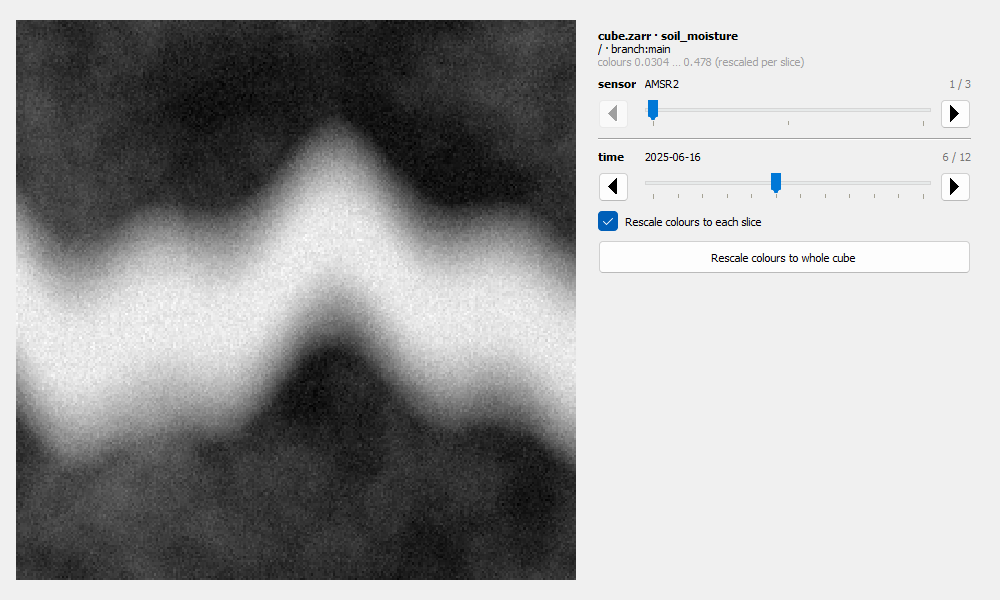
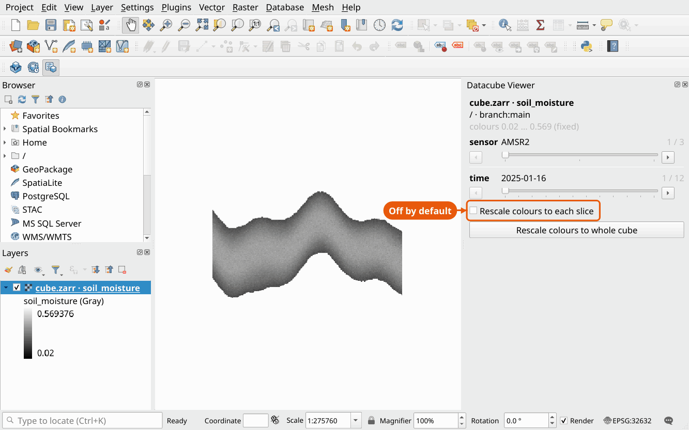
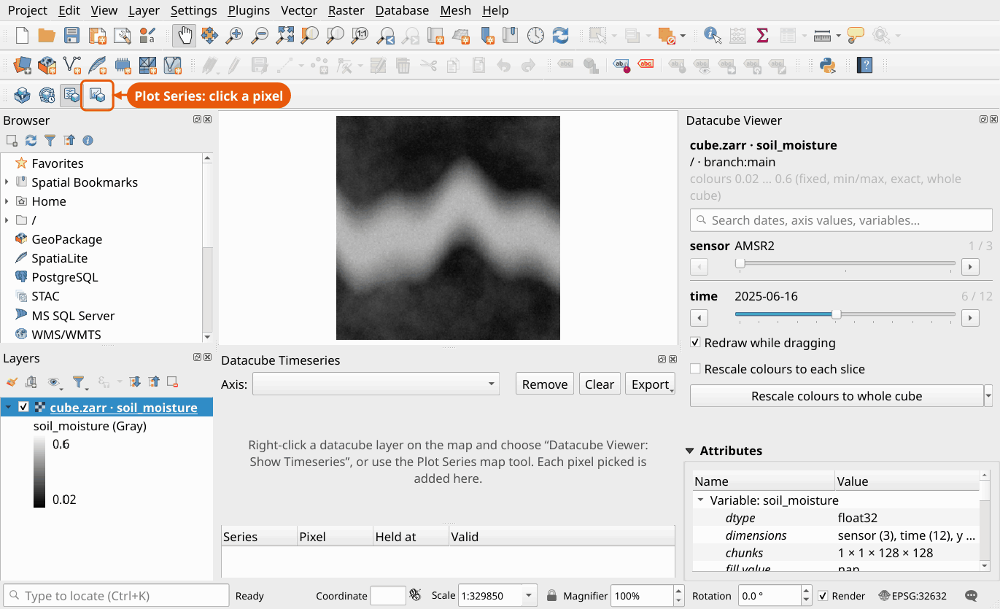

# Datacube Viewer

Loads multidimensional datacubes into QGIS as raster layers with multiscale pyramids.
It works with GeoZarr, NetCDF, regular Zarr stores (v2 and v3) and even [Icechunk](https://icechunk.io) repositories.

## Supported formats

| Format | Location | Dependencies |
| --- | --- | --- |
| **Icechunk** repository | local path, `s3://`, `gs://`, `az://`, `r2://`, `http(s)://` | `zarr`, `icechunk` |
| **Zarr** store (v3, and v2 with `_ARRAY_DIMENSIONS`) | local directory, `http(s)://` (needs consolidated metadata), `s3://`, `gs://`, `az://` | `zarr`; `fsspec` + a filesystem package for the cloud schemes |
| **NetCDF-4 / HDF5** and classic **NetCDF-3** file (`.nc`, `.nc4`, `.cdf`) | local file; OPeNDAP URL ending in `.nc` (untested) | `netCDF4` |

See [Formats](docs/formats.md) for how the format is detected and NetCDF details.

## Installation

The QGIS python ecosystem is fragile with respect to versions of python, QGIS, the installed operating system and package dependencies.

On Windows and macOS, QGIS comes with its own Python. Dependencies need to be installed with the bundled `pip` to take effect in QGIS. Depending on your system, there still might be dependency collisions. In that case use [QGIS from conda-forge][conda].
On Linux, QGIS uses the system Python. Installation of the plugin dependencies may or may not work depending on your system. We do not recommend tinkering with the system python packages and instead recommend using [QGIS from conda-forge][conda].

**Requirements:**
What you need depends on the formats you want to open and on your operating system.
The plugin itself requires QGIS 3.40 LTR or newer on every system.

| Plugin feature | Python version | Windows, macOS | Linux |
| --- | --- | --- | --- |
| **NetCDF** (`netCDF4`) | whatever QGIS runs on | QGIS 3.40 LTR or newer | QGIS 3.40 or newer; depends on distribution, we recommend using [QGIS from conda-forge][conda] |
| **Zarr** (`zarr >= 3`) | ≥ 3.11 | QGIS 3.40 LTR or newer (official installers bundle Python 3.12) | Depends on distribution, we recommend using [QGIS from conda-forge][conda] |
| **Icechunk** (`icechunk`) | ≥ 3.12 | QGIS 3.40 LTR or newer (official installers bundle Python 3.12) | Depends on distribution, we recommend using [QGIS from conda-forge][conda] |

Check your QGIS python version with `import sys; print(sys.version)` in **Plugins → Python Console**.

[conda]: docs/installation.md#qgis-from-conda-forge

### Install the plugin

- Open **Plugins → Manage and Install Plugins → All** and search for `Datacube Viewer`.
- Press **Install Experimental Plugin**. If it is not listed, tick **Settings → Show also experimental plugins**.
- Alternatively, install the `.zip` from the [GitHub releases](https://github.com/TUW-GEO/qgis-datacube-viewer/releases).

### Install plugin dependencies

Install what you need for your formats, or all of them:

| Package | Needed to support |
| --- | --- |
| `zarr>=3` | Zarr stores. |
| `icechunk` | Icechunk repositories, and their branches, tags and snapshots. |
| `netCDF4` | NetCDF files. |
| `fsspec` + `s3fs` | Plain Zarr on `s3://`, `gs://` and `az://`. For `gs://` use `gcsfs` and for `az://` use `adlfs` in place of `s3fs`. |

The easiest way is **Raster → Datacube Viewer → Install Python Dependencies…**: it
shows the command for your system and its **Install now** button runs it without
changing any package QGIS already has. To install by hand:

| | Where to run it | Command |
| --- | --- | --- |
| **Windows** | **OSGeo4W Shell** (Start menu → the QGIS folder). *Not* `cmd` or PowerShell: they have a different Python on `PATH`. | `python -m pip install --user "zarr>=3" netCDF4 icechunk fsspec s3fs` |
| **macOS** | **Terminal** (Applications → Utilities) | `/Applications/QGIS.app/Contents/MacOS/bin/python3 -m pip install --user "zarr>=3" netCDF4 icechunk fsspec s3fs` |
| **Linux** (system QGIS) | any terminal | not recommended! `/usr/bin/python3 -m pip install --user "zarr>=3" netCDF4 icechunk fsspec s3fs` |
| **conda** | any terminal where `conda` works | `conda install -p /path/to/env --override-channels -c conda-forge --freeze-installed "zarr>=3" netcdf4 icechunk fsspec s3fs` |

> [!IMPORTANT]
> **Restart QGIS after installing.** Packages are loaded once per session, so
> re-enabling the plugin is not enough.

See [Installation](docs/installation.md) for what the dialog does, common pitfalls and
what to do when your QGIS's Python is too old.

## Usage

The plugin adds four buttons to the toolbar, and the same entries under
**Raster → Datacube Viewer**:

|  |  |  |  |
| :---: | :---: | :---: | :---: |
| **Add Datacube Layer…** | **Time Travel…** | **Datacube Panel** | **Plot Series** |
| Load a datacube. | Choose an Icechunk snapshot. | Toggle the slider sidebar. | Plot a pixel along an axis. |

**Key features:**

- Step through time, sensor and any other non-spatial axis, redrawing as you drag.
- Plot a pixel along any axis, and compare several (right-click a location).
- Browse Icechunk branches, tags and snapshots.
- Search for dates, axis values and variables.
- One colour range over the whole cube, or per slice.
- Drag and drop data from your file manager onto QGIS, one or many at once.
- Load a subset of each axis: a date range, or a selection of sensors.
- Inspect the layer's metadata, as `ncdump -h` would.

| Pick a store, a version and the variables | Scrub through the axes |
| --- | --- |
|  |  |

Settings, under **Settings → Options → Datacube Viewer** (see [Usage](docs/usage.md#settings)):

- Automatically open slider sidebar
- Redraw while dragging a slider
- Fine dragging with Ctrl
- Drag-and-drop behavior
- Colour range of new layers
- Bilinear next to nodata

More in [Usage](docs/usage.md).

### Colour range

- **Default:** one range for the whole cube, so colours compare across slices.
- **Rescale colours to each slice:** every slice gets its own range.
- **Large cubes:** the range is estimated from a sample. **≤** / **≥** in the legend
  flag slices that exceed it.

Details in [Colour range](docs/colour-range.md).

### Timeseries

Right-click a datacube layer on the map, **Datacube Viewer: Show Timeseries**, and
pick an axis, or click with **Plot Series**. Each pick adds a line to the
**Datacube Timeseries** panel. See [Timeseries](docs/timeseries.md).

### NetCDF notes

- `_FillValue`, `scale_factor` and `add_offset` are applied, as for Zarr.
- On Windows, other programs cannot write to a file while it is open in QGIS.
- A plain `https://` link to a `.nc` file cannot be read in place; download it.

## Development

See [Development](docs/development.md) for environments, tests, releasing,
diagnostics and test data.

## Origin

Datacube Viewer is a fork of [EODC's GeoZarr Viewer](https://github.com/eodcgmbh/qgis-geozarr)
(MIT); see [UPSTREAM.md](UPSTREAM.md) for what changed. It was renamed so it stays
distinguishable from upstream and from Wietze Suijker's similarly named plugin when
several are installed at once.
