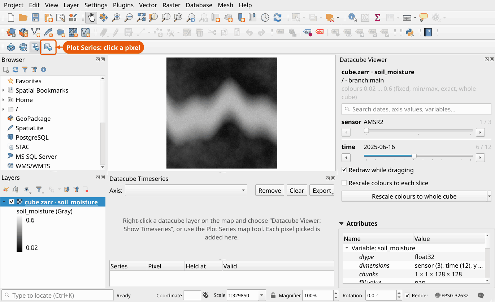

# Timeseries

## Picking a pixel

Right-click a datacube layer on the map and choose **Datacube Viewer: Show
Timeseries**, then an axis (**Along time**, **Along sensor**, ...). The values of the
pixel under the click, through every step of that axis, are added to the
**Datacube Timeseries** panel, and a marker in the line's colour and shape shows the
pixel on the map. Each pick adds another line, so you can compare places one by one.
Where several datacube layers cover the click, the menu lists each, with the selected
layer first. The menu shows with the Pan tool and with **Plot Series** (in the toolbar
and under **Raster → Datacube Viewer**), which also adds the pixel under a left click
along the axis the panel is showing.

A pick still reading after 5 seconds shows its progress above the map, with
**Cancel**; how long it takes depends largely on how the data is chunked. Closing
that message does not stop the read.

## What is read

The other axes stay where the layer's sliders are when you pick, and the list under
the plot says where (**Held at**, for example `sensor=2`). Values are read at full
resolution, like Identify, with scale factors applied; nodata steps leave a gap in
the line. A time axis is spaced by date, so a gap in acquisitions shows as one; a
numeric axis is spaced by value; other axes, such as sensor names, step evenly.

## The plot

Hover to read every line's value at that step, scroll to zoom the horizontal axis,
drag to pan and double-click to see everything again. Untick a series to hide it, and
**Remove** or **Clear** to take it off the plot and the map. The plot holds up to
eight lines, so the colours stay distinguishable. Series along different axes are
kept apart: **Axis** switches which ones are plotted. **Export** copies the values to
the clipboard or saves them as CSV (one row per series and step), or saves the plot
as an image.
